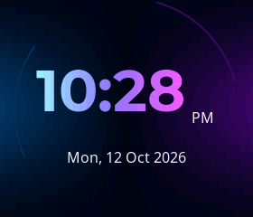

# Dynamic voice-controlled clock

The Pocket board keeps its animated face at startup. Say **show time**, **show me
the time**, **open clock**, **display clock**, or **show the clock** to open the
additional clock screen. **What's the time?**, **what time is it?**, and **tell me
the current time** open the same screen and use the existing Gemini audio reply
with the current local time. The clock has no timeout. Assistant speech,
Listening-state entry, reconnection, and reply completion do not dismiss it.
New user speech returns to the face; a new time request can reopen the clock.
Timers, alarms, reminders and incidental mentions of time do not open it.

This preview uses the production renderer and synthetic time. It is not a
photograph or evidence of physical panel quality. The correct weekday for
12 October 2026 is Monday. The firmware renders the actual synchronized date.

## Integration and repository review

Before implementation, the repository architecture/rules, build selection,
Pocket pins/configuration, common display/network interfaces, application
STT/TTS handlers, WebSocket/OTA time handling, audio engines and queues, face
animation/renderer, provisioning, backend provider/bridge/tools, test runner
and LVGL harness were reviewed. Vendor/generated components were inspected
for their APIs and fonts; unrelated board implementations were not rewritten.

`PocketDisplay` remains the single display controller. Its `ClockState` uses
`enum class DisplayMode { FACE, CLOCK }`. The existing face objects remain
allocated and are hidden as a group while the clock is shown. The same LVGL
timer observes actual captured microphone RMS/frame counts and advances the
clock. State changes occur under the existing display lock; no audio task or
network callback draws independently. Returning to FACE restores its listening,
thinking, speaking, emotional and blinking animations and opaque black root.

The classic ESP32's `LiteAudioEngine` has no local semantic VAD or wake-word in
this configuration. A sustained RMS gate therefore supplies the early display
transition: 100 ms of fresh captured energy above an adaptive noise threshold,
after 200 ms of quiet arming. Short clicks/stale buffers are ignored. Playback
state, nonempty output queues, and a 500 ms output tail suppress this gate.
Transcribed user text is the definitive fallback. This is an energy detector,
not a guarantee that arbitrary environmental noise can never dismiss the clock.
The existing half-duplex microphone/audio behavior is unchanged.

The backend assembles bounded per-turn input transcript fragments before
sending STT updates. Only user transcripts change the display mode. The Live
provider prompt uses `get_current_time` for both clock requests and spoken time;
the tool returns current UTC, the configured IANA local time and a natural 12h
spoken value. Device timezone metadata is optional, validated, and sent only
on the custom WebSocket backend; legacy clients and MQTT behavior are unchanged.

## Synchronization and timezone settings

Asia/Kolkata is the default. The phone setup page includes a timezone selector,
saved in the new `pocket_clock/timezone` NVS key. Existing credentials/volume and
pin assignments are preserved. Supported zones are Asia/Kolkata, Etc/UTC,
Asia/Dubai, Asia/Singapore, Asia/Tokyo, Europe/London, America/New_York and
America/Los_Angeles. An explicit IANA-to-POSIX mapping is used because newlib
does not ship the IANA timezone database. London/US zones include DST rules.
Unsupported/corrupt settings fall back to Asia/Kolkata.

The existing Wi-Fi worker starts nonblocking ESP-NETIF SNTP on connectivity
and restarts synchronization on reconnection. It never waits for sync on the
application, rendering or audio tasks. The standard RTC continues between
successful syncs and during Wi-Fi loss. Existing backend discovery UTC remains
a fallback when a network blocks NTP. Until time is valid, the clock shows
`--:--` and **Synchronizing time...**. Digits change on minute boundaries, and
date/AM-PM change correctly at midnight/noon.

USB commands `clock` and `home` show/close the clock for reproducible checks.
`diag` reports mode, valid time, local date and UI refresh counts. Use
`timezone Asia/Kolkata` (or another supported name) to save a zone without
re-entering Wi-Fi credentials. The display updates immediately; an already
open provider session uses its original timezone until the next session.

## Rendering and reproducible verification

The physical configuration remains ST7789, 280 × 240 landscape, RGB565, the
existing rotation/offsets and 11,200-byte partial strip. The clock creates three
LVGL objects. The 64px Montserrat Bold numeric subset is stored in flash with
its SIL license; regenerate it with `python scripts/pocket_clock_font.py`.
Anti-aliased glyphs are drawn through bounded 8px cyan/purple/magenta clipping
bands. Two background gradients and subtle arcs use ordinary LVGL primitives.
There is no canvas/full-frame allocation, image decoder or runtime font load.

The clock is polled at 20 Hz for microphone detection, but unchanged text
does not invalidate any graphics. Minute updates invalidate the digits area;
the date changes only when its formatted value changes. Show/hide transitions
use one ordinary refresh, with no separate clear or timed screen animation.

Run `python scripts/pocket_host_tests.py`, `npm test` in `backend`, and the
native LVGL harness described in `COMPANION_UI.md`. Clock captures include
minute/midnight/synchronization states and the restored face. The host tests
exercise production state/formatting code; renderer tests use the same font,
LVGL renderer and RGB565 strip as firmware.

| Requested case | Automated coverage / physical acceptance |
|---|---|
| 1. Boot face | Production state defaults to FACE; device boot check required |
| 2. Show time | Explicit intent tests; physical voice acceptance required |
| 3. Clock persists | No timeout, day-long simulated observations; USB persistence check |
| 4. Minute update | Production formatting plus partial LVGL redraw check |
| 5. Spoken time and sticky clock | Current-time tool/timezone tests; real voice acceptance required |
| 6. New unrelated speech restores face | Fresh RMS gate, transcript fallback and state tests; microphone acceptance required |
| 7. Normal reply stays face | FACE persists through playback observation tests |
| 8. Ask time again | Repeated command/state tests |
| 9. Midnight/date change | Production formatter and real LVGL midnight capture; timezone/DST backend tests |
| 10. Wi-Fi loss | Time runs independently; connectivity observation tests; physical disconnect/reconnect acceptance required |
| 11. Speaker does not dismiss clock | Playback/queue/tail suppression tests; physical acoustic acceptance required |
| 12. Rapid commands | 1,000 state requests and 100 real LVGL clock/face round trips without heap loss |

For physical acceptance, start with the face, ask **show me the time**, wait
through a minute boundary and the complete reply, then ask **tell me a joke**.
The face should return when you speak and remain afterward. Ask **what time
is it?** again: listen for the correct local time and check that the clock
stays. Repeat with Wi-Fi disconnected/reconnected and inspect `diag` for
continuing time and transfer/heap errors. These observations cannot be inferred
from compilation or a desktop screenshot.
